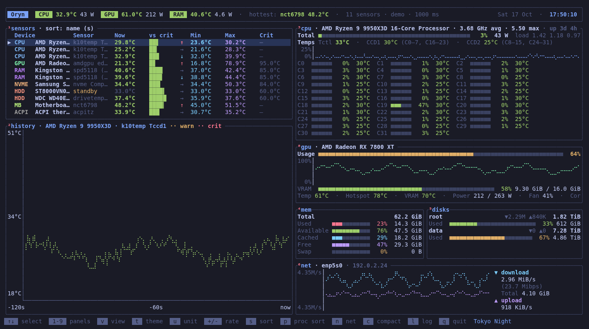

# Oryn

**A terminal hardware monitor that puts temperatures first.**

Oryn shows every temperature sensor in your machine in one table (CPU cores,
GPU edge, hotspot and individual VRAM chips, each RAM stick, NVMe, SATA and USB
drives, chipset, network cards), each with its live value, a bar against its
critical limit, min/max, trend and history graph. Around it sit btop-style
panels for CPU, GPU, memory, disks, network, processes and system specs, which
you can show, hide and rearrange.



<sub>Screenshot: `oryn --demo` in the Tokyo Night scheme, with simulated sensors and load.</sub>

## Features

- **Every sensor, named.** Each sensor is labelled with the hardware it
  belongs to ("Samsung SSD 990 PRO 2TB", "Kingston KF560C36BBE-32", "AMD
  Radeon RX 7800 XT") and a colored category (CPU, GPU, RAM, NVME, SSD, HDD,
  USB, NET…). Identical chips, such as two DDR5 sticks, each get their own row.
- **CPU:** package and per-core (Intel) or per-CCD (AMD) temperatures next to
  each core's usage, live clock speed, power draw in watts, load and a usage
  graph.
- **GPU:** NVIDIA (temperature, hotspot, per-chip VRAM temperatures on GDDR6X
  and GDDR7 cards, usage, VRAM, power, fan, clocks), AMD Radeon (edge,
  junction, memory temperature and the same load figures) and Intel (`xe` or
  `i915`: clock speed, usage as the share of time the GPU was awake, and for
  integrated GPUs, which have no sensor of their own, the CPU package
  temperature).
- **Drives:** SATA through the `drivetemp` driver, everything else through
  SMART. Sleeping hard drives are never woken up just to read them.
- **Processes:** btop-like list with search, start, terminate, kill and nice.
- **Compact mode** (`c`): only the temperatures, in a dense multi-column list.
- **100 color schemes**, mouse support, °C/°F, adjustable refresh rate.
  Your theme, panels and layout are remembered.

## Requirements

**To run it**

- **Linux** (x86_64 or aarch64). Oryn contains code for macOS and Windows
  too, but it hasn't been built or tested there yet.
- A terminal with UTF-8, 80×24 or larger (150 columns or wider for the
  two-column layout). 24-bit color is recommended.
- **Sensor drivers.** Most distributions load these automatically:

  | Hardware | Kernel driver |
  |----------|---------------|
  | Intel CPU | `coretemp` |
  | AMD CPU | `k10temp` |
  | DDR5 / DDR4 RAM | `spd5118` / `ee1004` (or `jc42`) |
  | NVMe drives | `nvme` (built in) |
  | SATA drives | `drivetemp` (usually **not** loaded by default) |
  | AMD GPU | `amdgpu` |

**Optional extras**

| Package | What it adds |
|---------|--------------|
| `smartmontools` | temperatures of SATA/USB drives without `drivetemp`, and of disks on macOS/Windows |
| NVIDIA driver (`nvidia-utils` on Arch) | NVIDIA GPU temperatures and the GPU panel; hotspot and VRAM chip readings come from its `libnvidia-api.so` |
| `hwdata` (Arch, Fedora) or `pci.ids` (Debian, Ubuntu) | readable names for GPUs, network cards and USB controllers |

**To build from source**

- Rust **1.85 or newer** with Cargo. The `cargo` packages of Arch and recent
  Fedora are new enough. On Debian and Ubuntu they are usually too old, so
  install Rust with [rustup](https://rustup.rs).
- A C linker (`gcc` or `clang`): `base-devel` on Arch, `build-essential` on
  Debian/Ubuntu.

## Installation

Every [release](https://github.com/rusty725/oryn/releases/latest) has
ready-made packages for x86_64 (64-bit Intel/AMD). On other machines
(aarch64…), [build from source](#any-linux-distribution-from-source).

| Package | For |
|---------|-----|
| `oryn-0.1.5-1-x86_64.pkg.tar.zst` | Arch Linux, CachyOS, EndeavourOS, Manjaro |
| `oryn_0.1.5-1_amd64.deb` | Debian 12+, Ubuntu 22.04+, Linux Mint, Pop!_OS |
| `oryn-0.1.5-1.x86_64.rpm` | Fedora, RHEL / Rocky / Alma 9+, openSUSE |
| `oryn-0.1.5-x86_64-linux.tar.gz` | any other x86_64 Linux with glibc 2.34+ |

Each package installs the `oryn` command and its man page (`man oryn`).
The commands below download the file into the current folder and install
it. To check a download first, get `SHA256SUMS` from the same release and
run `sha256sum -c --ignore-missing SHA256SUMS`.

### Arch Linux, CachyOS, Manjaro

```sh
curl -LO https://github.com/rusty725/oryn/releases/download/v0.1.5/oryn-0.1.5-1-x86_64.pkg.tar.zst
sudo pacman -U oryn-0.1.5-1-x86_64.pkg.tar.zst
sudo pacman -S --needed --asdeps smartmontools hwdata   # optional extras
```

Or build the package yourself: the [PKGBUILD](pkg/arch/PKGBUILD) downloads
the release source, builds it, runs the tests and installs it.

```sh
git clone https://github.com/rusty725/oryn.git
cd oryn/pkg/arch
makepkg -si
```

### Debian, Ubuntu, Linux Mint, Pop!_OS

```sh
curl -LO https://github.com/rusty725/oryn/releases/download/v0.1.5/oryn_0.1.5-1_amd64.deb
sudo apt install ./oryn_0.1.5-1_amd64.deb
sudo apt install smartmontools          # optional extra
```

The `./` matters: without it `apt` looks for a package called that name
in its repositories instead of the file.

### Fedora, RHEL, Rocky, AlmaLinux

```sh
curl -LO https://github.com/rusty725/oryn/releases/download/v0.1.5/oryn-0.1.5-1.x86_64.rpm
sudo dnf install ./oryn-0.1.5-1.x86_64.rpm
```

`dnf` also installs the recommended `smartmontools` and `hwdata`.

### openSUSE

```sh
curl -LO https://github.com/rusty725/oryn/releases/download/v0.1.5/oryn-0.1.5-1.x86_64.rpm
sudo zypper install --allow-unsigned-rpm ./oryn-0.1.5-1.x86_64.rpm
```

### Any other Linux: the .tar.gz

A plain binary plus the man page, for distributions without a package
above. Needs glibc 2.34 or newer (`ldd --version` shows yours).

```sh
curl -LO https://github.com/rusty725/oryn/releases/download/v0.1.5/oryn-0.1.5-x86_64-linux.tar.gz
tar xzf oryn-0.1.5-x86_64-linux.tar.gz
cd oryn-0.1.5-x86_64-linux
sudo install -Dm755 oryn /usr/local/bin/oryn
sudo install -Dm644 oryn.1 /usr/local/share/man/man1/oryn.1
```

### Any Linux distribution: from source

```sh
git clone https://github.com/rusty725/oryn.git
cd oryn
cargo build --release
sudo install -Dm755 target/release/oryn /usr/local/bin/oryn
```

Or let Cargo fetch and build it into `~/.cargo/bin`:

```sh
cargo install --locked --git https://github.com/rusty725/oryn
```

## Uninstall

Remove it the same way it was installed:

| Installed with | Remove with |
|----------------|-------------|
| Arch package (`pacman -U` or `makepkg -si`) | `sudo pacman -R oryn` |
| `.deb` | `sudo apt remove oryn` |
| `.rpm` on Fedora / RHEL | `sudo dnf remove oryn` |
| `.rpm` on openSUSE | `sudo zypper remove oryn` |
| `.tar.gz` | `sudo rm /usr/local/bin/oryn /usr/local/share/man/man1/oryn.1` |
| from source | `sudo rm /usr/local/bin/oryn` |
| `cargo install` | `cargo uninstall oryn` |

Packages don't touch your settings. To remove those too:

```sh
rm -r ~/.config/oryn
sudo rm -f /etc/sudoers.d/oryn-smartctl   # only if you added the smartctl rule below
```

## After installing

**Load the SATA drive driver** if you have SATA disks, so their temperatures
show up without root:

```sh
sudo modprobe drivetemp
echo drivetemp | sudo tee /etc/modules-load.d/drivetemp.conf   # keep it after reboot
```

**Run with sudo for the extras.** Everything above works as a normal user.
A few readings need root: SMART drive temperatures, RAM part numbers (read
from each stick's own chip), CPU power draw and the hotspot on NVIDIA RTX 50
cards.

```sh
sudo oryn
```

Your theme and layout are the same with or without `sudo`. If Cargo
installed Oryn to `~/.cargo/bin`, use `sudo ~/.cargo/bin/oryn`, because sudo
doesn't search your own PATH.

**Or allow just `smartctl` without a password.** When it isn't root, Oryn
tries `sudo -n smartctl` on its own (it never asks for a password), so with
this rule SMART temperatures work from a normal `oryn`:

```sh
SMARTCTL=$(sudo sh -c 'command -v smartctl')   # /usr/bin or /usr/sbin, depending on the distro
echo "$USER ALL=(root) NOPASSWD: $SMARTCTL" | sudo tee /etc/sudoers.d/oryn-smartctl
sudo chmod 440 /etc/sudoers.d/oryn-smartctl
```

**Check what was found** at any time:

```sh
oryn --list       # every sensor with its value, then exit
oryn --gpu-info   # why NVIDIA hotspot / VRAM temperatures are or aren't available
oryn --demo       # simulated sensors, to try the interface anywhere
oryn --mem-probe  # check which part of Oryn, if any, keeps memory (about a minute, no UI)
```

## Usage

```sh
oryn                       # start
oryn --theme dracula       # pick a color scheme (oryn --themes lists all 100)
oryn --panels sensors,cpu  # show only some panels (or all,-proc for all but one)
oryn --compact             # start in compact mode
oryn -i 500                # refresh every 500 ms (100–10000)
```

Press **v** to choose and arrange panels, **t** to pick a color scheme, **c**
for compact mode, **Tab** to switch to the process list and **q** to quit.
Settings are saved in `~/.config/oryn`. The rest of this page is the full
reference.

## Keys

| Key        | Action                      |
|------------|-----------------------------|
| ↑/↓, k/j   | select sensor for the chart |
| Tab        | move the keys between the sensor table and the process list |
| t          | color scheme picker (live preview; Enter keeps, Esc cancels) |
| T          | cycle to the next color scheme |
| u          | toggle °C / °F              |
| + / -      | refresh interval +100 ms / −100 ms (100 ms – 10 s) |
| s          | sort by name / hottest      |
| r          | reset min/max and history   |
| l, L       | write everything shown to a log in `/tmp` (see [Log](#log)) |
| q, Esc     | quit                        |

The mouse works too: the wheel scrolls and a click selects, in both the sensor
table and the process list. Hold Shift to select text with the mouse.

Colors: green < warn ≤ yellow < crit ≤ red. Warn is 80% of the sensor's
reported critical temp (or 70 °C if it reports none); crit is the reported
critical temp (or 90 °C).

## Process list

Press **Tab** to put the keys on the process list (its border lights up). If
the sensor table is hidden, the process list has them anyway. An action bar on
the panel's bottom border shows what you can do, like in btop, with the
selected row and the total in the corner (`12/566`, or `3/8 of 566` while
filtering):

| Key             | Action |
|-----------------|--------|
| ↑/↓, PgUp/PgDn, Home/End, wheel | select and scroll |
| f or /          | filter by program, command line, user or PID as you type; Enter keeps the filter, Esc clears it |
| e               | start a command. It runs in the background, detached from Oryn, with no terminal output, and keeps running after you quit |
| t               | terminate the selected process (SIGTERM) after a y/n check |
| k               | kill it (SIGKILL) after a y/n check |
| n               | set its nice value (-20 to 19). Type the number or use ↑/↓, then Enter |
| p               | cycle sort: cpu, mem, pid, name |
| Esc             | clear the filter (quits when there's none) |

The selection stays on the same process when the list re-sorts. The **Ni**
column shows each process's nice value. Results and errors (such as
*permission denied*) appear on the panel for a few seconds. Stopping other
users' processes and lowering nice below its current value need root, so run
`sudo oryn` for those. While the process list has the keys, **t** and **n**
act on processes, so use **T** to change the theme. Zombie processes (already
exited, waiting for their parent to collect them) aren't listed.

## Header

The top bar shows the temperature and power draw of the CPU, the GPU and the
RAM, the hottest sensor, a clock (local date and time, ticking every
second) and Oryn's version: `CPU 63.1°C 87 W   GPU 52.0°C 254 W   RAM 41.5°C 5.2 W · hottest …`.
Each badge is colored by its temperature (green, yellow, red). With several
graphics cards, the GPU badge shows the hottest card and their power added up;
with several memory sticks, the RAM badge shows the hottest one.
An integrated GPU gets its own **iGPU** badge, so on a laptop with both an
integrated and a discrete GPU the two aren't mixed.

On laptops, tablets and handhelds a **BAT** badge shows the battery: charge,
time left or charging, and the charge/discharge rate (`BAT 54% 2h 10m left
8.4 W`, `BAT 87% charging 1h 05m 25 W`, `BAT 100% full`). It's colored yellow
at 25 % and red at 10 %. Desktops don't get one; batteries of wireless mice,
keyboards and controllers are ignored.

**Power draw.** GPU watts come from the driver: `nvidia-smi` for NVIDIA,
`power1_input` / `power1_average` for AMD. CPU watts are worked out from the
CPU's own energy counter (Linux RAPL, `/sys/class/powercap/intel-rapl:*`, which
covers Intel and AMD Zen 2 and newer), so the first figure appears one refresh
after start. That counter is readable by root only on current kernels, so as
a normal user the CPU panel shows `power — (run with sudo)`; on boards using
the `zenpower` driver, CPU power is read from it instead, without root. RAM
watts come from the same counter's `dram` zone, which only some Intel CPUs
(mostly servers) provide and which also needs root; without it the RAM badge
shows just the temperature.

## Log

Press **l** (or **L**) to write everything Oryn is showing to a text file in `/tmp`,
named after the date and time (`/tmp/oryn-20261017-164503.log`); the footer
says where it went. It has the header figures, every sensor with its current,
min, max and critical temperature (all of them, not only the rows that fit on
screen), and a section for each panel that is switched on: CPU with every
core, memory, disks, network, GPUs, the whole process list (as filtered) and
the system specs. Hidden panels are left out, since their figures aren't kept
up to date; in compact mode the log has the temperatures and GPUs only. The
file is readable only by you, also under `sudo`, because process command
lines can contain private details.

## Compact mode

Press **c** for a compact view: every temperature (all sensors, plus GPU
hotspot and VRAM) in a dense list with no bars or graphs, grouped by category
and flowing into as many columns as the terminal is wide. CPU, memory, disk,
network and process polling stops while it's on. The mode is remembered;
`--compact` starts in it.

## Panels

Like btop, every panel can be shown or hidden:

| Key | Panel   | Shows |
|-----|---------|-------|
| 1   | sensors | temperature table |
| 2   | history | temperature chart for the selected sensor |
| 3   | cpu     | live clock speed (average and fastest core), power draw, total usage, history, every core, load, uptime |
| 4   | mem     | total / used / available / cached / free / swap |
| 5   | disks   | each filesystem's usage and read/write speed |
| 6   | net     | download/upload graph, speeds, totals (`n` = next interface) |
| 7   | proc    | processes: scroll, filter, start, terminate, kill, nice (see [Process list](#process-list)) |
| 8   | gpu     | GPU usage, VRAM, temperatures, power, fan, clocks, VRAM chips |
| 9   | specs   | OS, kernel, host, uptime, board/BIOS, CPU, GPU (with VBIOS version), RAM sticks, drives (with firmware version), network adapters with model and driver ("Realtek RTL8126 5GbE Controller · r8169 driver"), desktop with its version ("KDE Plasma 6.2.4 · Wayland"), shell, terminal |

### Arranging panels

In the **v** menu (rows are listed in layout order):

| Key | Action |
|-----|--------|
| Space | show / hide the highlighted panel |
| Ctrl+Shift+↑ / Ctrl+Shift+↓ (or K / J) | move it up / down (Shift+↑ / ↓ alone works too in terminals that don't use it for scrolling) |
| ← / → (or h / l) | put it in the left / right column (wide terminals) |
| d | back to the default layout |

The default layout balances itself so no column is left half empty; once
you rearrange, your order is followed exactly (the last panel in each column
still stretches to the bottom, and memory + disks next to each other share a
row). Order and columns are saved with the panel choices.

Press **1–9** to toggle a panel, or **v** for a checklist of all of them
(Space toggles, `a` turns all on). The choice is saved to
`~/.config/oryn/panels`; `--panels sensors,cpu,net` (or `all`) overrides it
for one run. Hidden panels aren't polled, so hiding the process list also
saves CPU. On terminals 150+ columns wide, temperatures go on the left and
system panels on the right; narrower terminals stack them.

The CPU panel's title shows the clock speed the cores actually run at,
refreshed every tick: the average over all cores and the fastest one
(`4.21 GHz avg · 5.62 max`; a single number when they're about equal). On
Linux it comes from the kernel's measured average (`cpuinfo_avg_freq`, Linux
6.14+), else from `/proc/cpuinfo` (measured the same way on x86), and only as
a last resort from `scaling_cur_freq`, which on newer kernels is just the
speed the driver asked for.

The specs panel's **Desktop** line names your desktop environment or
compositor with its version, e.g. `KDE Plasma 6.2.4 · Wayland` or
`GNOME 47.1 · X11`. It recognises KDE Plasma, GNOME, Cinnamon, MATE, Xfce,
LXQt, LXDE, Budgie, COSMIC, Pantheon, Deepin, Enlightenment, Hyprland, Sway,
niri, river, labwc, Wayfire, i3, bspwm, awesome and Openbox; the version is
what the desktop's own program prints for `--version` (COSMIC, Pantheon,
Deepin, Enlightenment and LXDE show without one). Under `sudo` or over SSH,
where the desktop variables aren't set, it's found from the desktop's
running process instead.

When the window is too short for every panel that's switched on, Oryn leaves
out the least important ones rather than squeezing them all until none is
readable: specs first, then processes, network, memory/disks, history, GPU and
CPU; the sensor table always stays. The bottom bar says which are hidden
(`3 hidden: specs, net, proc (window too small)`), and they come back as soon
as there's room.

## Categories

Each row is tagged and the list is grouped in this order:
`CPU` `GPU` `RAM` `NVME` `SSD` `HDD` `USB` `NET` `WIFI` `AUDIO` `MB`
(motherboard sensor chip) `CHIP` (chipset/bridges) `ACPI` `BAT`.
SATA drives are split into `SSD` and `HDD` by the kernel's rotational flag (or
SMART's rotation rate); PCI devices are tagged by their PCI class.

## Color schemes

99 schemes plus `Terminal` (your terminal's own palette, the default), listed
alphabetically in the picker (`t`; PgUp/PgDn jump by 10, Home/End):

Alucard, Andromeda, Aura Dark, Ayu Dark, Ayu Light, Ayu Mirage, Base16
Eighties, Bluloco Dark, Bluloco Light, Catppuccin Frappé, Catppuccin Latte,
Catppuccin Macchiato, Catppuccin Mocha, Cobalt2, Darcula, Dawnfox, Dayfox,
Doom One, Dracula, Duskfox, Edge Dark, Edge Light, Embark, Everblush,
Everforest, Everforest Light, Flexoki Dark, Flexoki Light, GitHub Dark, GitHub
Dark Dimmed, GitHub Dark High Contrast, GitHub Light, Gruvbox Dark, Gruvbox
Dark Hard, Gruvbox Light, Gruvbox Material, Gruvbox Material Light, Horizon,
Iceberg, Jellybeans, Kanagawa, Kanagawa Dragon, Kanagawa Lotus, Material
Darker, Material Lighter, Material Ocean, Material Palenight, Modus Operandi,
Modus Vivendi, Molokai, Monokai, Monokai Pro, Monokai Pro Machine, Monokai Pro
Octagon, Monokai Pro Ristretto, Monokai Pro Spectrum, Moonfly, Night Owl,
Night Owl Light, Nightfly, Nightfox, Nord, Nordfox, Oceanic Next, One Dark,
One Light, Panda, PaperColor Dark, PaperColor Light, Poimandres, Rosé Pine,
Rosé Pine Dawn, Rosé Pine Moon, Selenized Black, Selenized Dark, Selenized
Light, Shades of Purple, Snazzy, Solarized Dark, Solarized Light, Sonokai,
Spacegray, Synthwave '84, Tango Dark, Tango Light, Tokyo Night, Tokyo Night
Day, Tokyo Night Moon, Tokyo Night Storm, Tomorrow, Tomorrow Night, Tomorrow
Night Blue, Tomorrow Night Bright, Ubuntu, VS Code Dark+, VS Code Light+,
Xcode Dark, Xcode Light, Zenburn.

Colors follow each scheme's published palette. One exception: the colors
that carry meaning here (ok / warm / critical, accent) are nudged darker or
lighter, keeping their hue, when a scheme's own value would be too faint on
its background — e.g. the pale yellows of some light themes.

The last choice is saved to `~/.config/oryn/theme` and used next time;
`--theme <name>` overrides it for one run (names are forgiving:
`tokyo-night`, `TokyoNight`, `rose-pine` all work). The schemes use 24-bit
color, which every modern terminal supports; on one that doesn't, use
`Terminal`.

## Device names

On Linux each row shows the hardware it belongs to:

| Hardware          | Example                    | Source                               |
|-------------------|----------------------------|--------------------------------------|
| CPU               | AMD Ryzen 9 7950X          | `/proc/cpuinfo`                      |
| NVMe / SATA drive | Samsung SSD 990 PRO 2TB    | the drive's `model`                  |
| GPU, Wi-Fi, …     | AMD Radeon RX 7900 XT/…    | PCI IDs looked up in `pci.ids`       |
| RAM stick         | Kingston KF560C36BBE-32    | the DIMM's SPD EEPROM (maker + part) |
| Motherboard chip  | Motherboard (nct6798)      | chip name                            |

RAM part numbers need the DIMM's SPD EEPROM to be readable, which on most
systems means running as root (`sudo oryn`). Without it, sticks show as
`RAM DIMM @0x50`, `@0x51`, … (their bus address). Memory soldered to the
board (most laptops) has no SPD chip; the specs panel then lists the modules
the BIOS reports (SMBIOS type 17), which also needs root. GPU names need
`pci.ids` (package `hwdata` or `pciutils`).

## GPU temperatures

- **AMD** (`amdgpu`: edge, junction/hotspot, memory), **Intel** (`xe`) and
  **NVIDIA with the open `nouveau` driver** are read from Linux sysfs.
- **NVIDIA with NVIDIA's own driver** doesn't publish temperatures there, so
  Oryn starts one `nvidia-smi` process (installed with the driver) that
  streams a reading per refresh interval. No root needed; works on Windows too.
  It shows the core temperature, plus memory on data-center cards with HBM;
  GeForce cards don't expose hotspot or memory temperature through
  `nvidia-smi`. Crit is the card's own slowdown temperature.

### VRAM and hotspot temperature

The GPU panel shows VRAM (memory) and hotspot temperatures wherever they
can be read:

- **AMD**: always, from `amdgpu`'s `mem` and `junction` channels.
- **NVIDIA data-center cards with HBM**: from `nvidia-smi`.
- **NVIDIA GeForce**: through **NvAPI** (`libnvidia-api.so.1`, installed with
  NVIDIA's driver), using the same undocumented, read-only calls as
  [LACT](https://github.com/ilya-zlobintsev/LACT): the thermal channels for
  hotspot/VRAM, the RTX 50 hotspot register, and the per-chip GDDR6X/GDDR7
  memory registers (the panel shows the hottest chip). Ported from LACT's
  MIT-licensed code. **RTX 50 hotspot needs root**: NVIDIA's driver lets
  normal users read the memory-temperature registers but not the on-die
  sensor block, so run `sudo ./target/release/oryn` for hotspot (VRAM works
  either way). On RTX 50 the whole sensor window is scanned and the hottest
  tagged reading shown (method from
  [nvidia-gpu-sensors](https://github.com/philipl/nvidia-gpu-sensors), MIT),
  since which slots are populated differs between models. Turn NvAPI off
  with `--no-nvapi`. The [gddr7-temp](https://github.com/sunnyyangyangyang/gddr7-temp)
  kernel module is also picked up if you use it.

Run `oryn --gpu-info` to see, for your exact card, what can be read,
whether gddr7-temp supports it, and what's missing.

## Hard drive (HDD/SSD) temperatures

Disks are read from two places, without duplicates:

1. **`drivetemp` kernel driver** (Linux, SATA): fast, read every refresh, no
   root needed. Enable it with `sudo modprobe drivetemp` (and add `drivetemp`
   to `/etc/modules-load.d/drivetemp.conf` to keep it after reboot). Rows look
   like `drivetemp (sda)`.
2. **SMART via `smartctl`** (package `smartmontools`) for every other disk,
   on Linux, Windows and macOS. Polled every 30 s in the background with
   `-n standby`, so **sleeping disks are never spun up**: they show `standby`
   with their last known temperature. SMART needs root/admin
   (`sudo oryn`); otherwise rows show `needs root`.

NVMe drives come from the kernel's `nvme` driver on Linux. If a SATA disk shows
`modprobe drivetemp`, neither source is available yet; either fix above works.
Warn/crit for disks: the drive's own limit if it reports one, otherwise 60 °C
for hard drives and 70 °C for SSDs.

## CPU temperatures in the CPU panel

- **Intel** (`coretemp`): every core shows its own temperature next to its
  usage, plus Package and the hottest core.
- **AMD** (`k10temp`): Linux exposes Tctl and one temperature per CCD
  (chiplet), not per core. Like btop, each core shows its CCD's temperature;
  the Temps line says which cores each CCD covers (`CCD1 52°C (C0–7, C16–23)`).
  Cores are matched to their CCD by shared L3 cache.

Core temperatures use the same colors as the sensor table (green, yellow
from 80 % of the sensor's limit, red at the limit) and follow `u` for °C/°F.

## VRAM chips

On NVIDIA GDDR6X/GDDR7 cards the GPU panel lists every memory chip, labelled
like LACT (`A0 56°C  A1 56°C  B0 62°C …`; ` F`/` B` front/back on clamshell
boards), hottest in bold. VRAM in the stats line is the hottest chip.

## CPU temperature

The header always shows the CPU temperature: the package / Tdie / Tctl sensor
when present, otherwise the hottest CPU sensor. CPU rows are tagged `CPU` and
listed first. Recognized CPU sources: `coretemp` (Intel), `k10temp` / `zenpower`
(AMD), and the `x86_pkg_temp` / `cpu*` thermal zones.

## Platform notes

- **Linux**: reads `/sys/class/hwmon` and `/sys/class/thermal` directly. Each
  sensor is keyed by its chip and the device it belongs to, so identical chips (e.g. two `spd5118`
  DDR5 DIMM sensors) each get their own row, labelled with their bus address.
  If something is missing, `oryn --list` shows exactly what was found, and
  `sudo modprobe coretemp` / `k10temp` / `spd5118` loads the usual drivers.
  Sensors that appear while Oryn runs (a drive plugged in, a driver loaded)
  show up within 5 seconds; one that goes away says `disconnected` instead of
  keeping its last temperature. Values sensors use to mean "no reading"
  (e.g. -128 °C or 255 °C from unconnected motherboard inputs) are shown as n/a.

- **macOS, Windows**: the code has paths for both (sensors through sysinfo,
  disks through `smartctl`), but they haven't been built or tested yet.

## Credits

- **[btop](https://github.com/aristocratos/btop)** by Aristocratos: the look
  and feel of Oryn's system panels (CPU, memory, disks, network, processes),
  the superscript toggle keys in panel titles and the process list's action
  bar are modelled on btop. Oryn is a separate program written from scratch in
  Rust and contains no btop code.
- **[LACT](https://github.com/ilya-zlobintsev/LACT)** by Ilya Zlobintsev: the
  NvAPI method for NVIDIA hotspot, memory and per-chip VRAM temperatures (MIT).
- **[nvidia-gpu-sensors](https://github.com/philipl/nvidia-gpu-sensors)** by
  Philip Langdale: the RTX 50 hotspot register scan (MIT).
- The color schemes are by their respective authors (Dracula, Nord, Catppuccin,
  Tokyo Night, Gruvbox, Solarized and the rest); Oryn uses their published
  palettes.
- Built with [ratatui](https://ratatui.rs), [crossterm](https://github.com/crossterm-rs/crossterm)
  and [sysinfo](https://github.com/GuillaumeGomez/sysinfo).

## License

MIT, see [LICENSE](LICENSE). Code adapted from LACT and nvidia-gpu-sensors
keeps its original MIT notices in [THIRD_PARTY_NOTICES.md](THIRD_PARTY_NOTICES.md).
